# otonasi-muonn 

## 📊 GitHub 統計

  <!-- GitHub Stats (安定している元のURLを使用し日本語化) -->
  
  <!-- Top Languages (安定している元のURLを使用し日本語化) -->
  

  <!-- GitHub Streak (継続日数の可視化・日本語化) -->
  

  <!-- GitHub Profile Trophy (実績をトロフィーで表示) -->
  

## 🧪 CSSで計算するSVG（実験）

JavaScriptもサーバーも使わず、**画像ファイル内のCSSが数値を二乗**して、7セグメント表示器に結果を描画します。

**仕組み:** CSSアニメーションが `n` を変化させ、`calc()`・`mod()`・`round()`・`if()` が計算と描画を担当。HTMLやJavaScriptは画像の内部にありません。

※ Chromium 144の``環境では演算・表示を確認。**GitHubのREADME上で同じように動くかは、この実験で検証します。** 非対応ブラウザや画像処理環境では静止表示になる場合があります。

表示が動かないときの比較テスト

下の2つの点は、それぞれ通常のCSSアニメーションとSVG標準のアニメーション（SMIL）で点滅する比較対象です。

- 両方止まる：画像のアニメーション自体が無効になっている可能性
- 比較テストは動くが計算画像は止まる：高度なCSS機能への非対応などの可能性

### 🧠 記憶するSVG：フィボナッチ計算

前の2つの数を**CSSの中に保持し、足し算して次の数を作るSVG画像**です。単なる数字のアニメーションではなく、前回の計算結果を使って更新します（値は100で折り返します）。

下は同じ演算ルールで、開始値だけ `(2,3)` に変えた対照実験です。

**ローカル検証:** Chromium 144 / JavaScript無効 / ``表示で、2種類×7枚のスクリーンショットを画像解析。表示された `A`・`B`・`NEXT` が各フレームで `NEXT = (A+B) mod 100` を満たすことを確認済み。

**未確認:** GitHub READMEの画像配信経路で「状態を保持した更新」が継続するか。非対応環境では静的表示になる場合があります。
